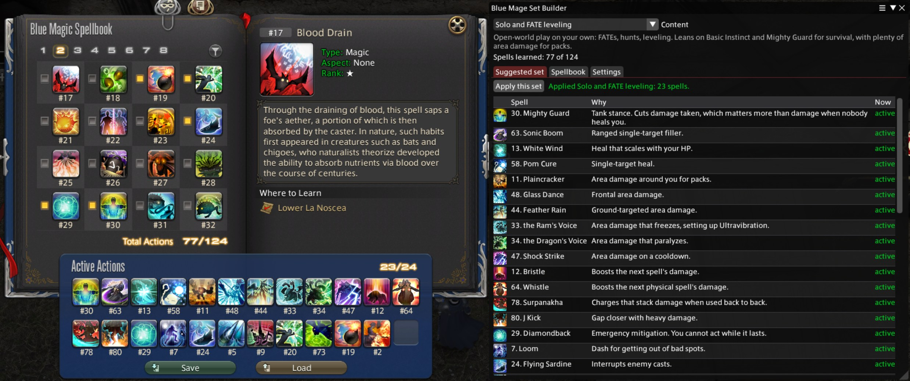

# Blue Mage Set Builder

A Dalamud plugin for FINAL FANTASY XIV. It reads which Blue Mage spells you have
learned and builds a 24-spell active set for the content you are about to do, then
applies it with one click.

The point is to skip working out, every time you switch from FATEs to a dungeon to a
trial, which 24 of your spells to bring, and then ticking them one by one in the Blue
Magic Spellbook.



## Features

- Eight profiles: **open world and FATEs**; **solo duties** (built around Basic
  Instinct, which only works there); and **DPS**, **tank** and **healer** sets for
  both **dungeons** (area damage and sustain for trash pulls) and **trials and raids**
  (single-target damage, tankbuster mitigation, raid-wide healing).
- A set for every **Masked Carnivale** stage, built around the spells
  [Blue Academy](https://mage.blue/masked-carnivale/) lists as required or
  recommended for it, with each act's enemies and their vulnerabilities from the game's
  briefing data, and a button that opens Blue Academy's full guide for the stage.
- A suggested set built from the spells you actually know, with the reason each one
  made the cut and which are already active.
- Hover any spell for a tooltip like the game's: cast, recast, MP cost, range and
  radius, the spell's description in the game's own colours, then its spellbook page
  with type, aspect, rank, lore and where to learn it.
- A **Worth learning** list: spells the profile wants that you do not have yet, and
  where to learn each one.
- Where to learn each spell names the creature, not just the place, and which boss it
  is when that is known: "The Wanderer's Palace: Tonberry King, last boss". The
  tooltip lists every known source, since many spells can be learned in several places.
- When a profile's first choice is not learned, a weaker stand-in takes the slot and
  says what it is standing in for, so a low-level Blue Mage still gets a usable set.
- Any slots left once a profile runs out of picks are topped up with generally useful
  spells you know, marked as extras, so the set is never left with gaps.
- The whole spellbook in one table: number, rank, learned or not, and where to get it,
  with a search box that matches the name, the spellbook number, the place, or the
  creature that teaches it.
  Any spell can be excluded from every suggestion, for example one you find awkward.
- Spells are laid out in the profile's order by default. Turn on **Keep spells in the
  same slot** to leave spells that are already active where they are, so as little
  moves as possible.
- Aetheric Mimicry and cooldowns handled for you: spells cannot be changed while
  Mimicry is up or while a spell that would move is recasting. The button offers to
  end Mimicry by recasting it, waits out the cooldowns, applies the set, and reminds
  you to mimic again.
- `/blusets apply <profile>` for macros.
- Profiles are a plain JSON file you can export, edit in any text editor, and reload
  without touching the plugin.

## Installing

The plugin is distributed through my custom Dalamud repository.

1. Type `/xlsettings` in game.
2. Open the **Experimental** tab.
3. Paste this into the empty box under **Custom Plugin Repositories**:

   ```
   https://raw.githubusercontent.com/joshua88wa/FFXIV/main/Dalamud/repo.json
   ```

4. Press **+**, make sure the checkbox next to it is on, then press **Save and Close**.
5. Open `/xlplugins`, search for Blue Mage Set Builder, and install it.

If nothing shows up, press the refresh icon at the top left of the plugin installer.

Other plugins in the same repository are listed at
[joshua88wa/FFXIV](https://github.com/joshua88wa/FFXIV).

## Using it

1. Type `/blusets`.
2. Pick what you are about to do from **Content**. Profiles are grouped under General,
   Dungeons, and Trials and raids. Choosing **The Masked Carnivale** adds a **Stage**
   picker listing all 32 stages, with each act's enemies and what they are vulnerable
   to, straight from the game's briefing data. Each stage's set starts with the spells
   Blue Academy lists for it and is topped up with generally useful Carnivale spells.
   Stages where Blue Academy lists no particular spells get the general Carnivale set.
   **Open the stage guide** takes you to Blue Academy's page for that stage, which has
   the actual strategy.
3. Read down the suggested set. Each spell shows why it was picked. Above the list, a
   line says whether the set wants any spells you have not learned, with a button that
   jumps to where to learn them. For a Carnivale stage, spells Blue Academy lists as
   required are named right there, in orange, if you do not have them.
4. Press **Apply this set**.

The window works on any job, so you can plan from anywhere, but applying needs you to
be on Blue Mage.

## Commands

- `/blusets` opens or closes the window
- `/blusets apply <profile>` applies a profile. Takes a profile id or the start of its
  name, so `/blusets apply trial` works. The ids are `solo`, `soloduty`, `dungeon`,
  `dungeontank`, `dungeonhealer`, `boss`, `tank` and `healer` (the last three are
  the trial and raid sets). `/blusets apply stage 12` applies a Masked Carnivale stage
  set, and `/blusets apply carnivale` applies the stage selected in the window.
  With no name it applies the profile selected in the window.
- `/blusets config` opens the settings tab
- `/blusets debug` prints what the plugin can see to chat, which is the first thing to
  include in a bug report

## When spells cannot be changed

The game refuses to change spells in combat, mid-cast, while zoning or in a cutscene,
while Aetheric Mimicry is active, and once a Masked Carnivale stage has started. The
plugin checks for all of these before trying except the Carnivale lock, which it
reports when the game refuses.

More generally, the game will not move or remove a spell while it is on cooldown or
while the buff it gave you is still up. Mighty Guard and Aetheric Mimicry are the
usual culprits. The plugin works out from the game's data which buff belongs to which
spell, so it does not rely on a hand-made list. When a spell that would move still
has its buff on you, the button changes to name it, for example **End Mighty Guard
and apply**, and ends it the way you would:

- Mighty Guard and Aetheric Mimicry end when cast again, so it recasts them (stand
  still during the cast).
- Buffs the game lets you click off are clicked off.
- Buffs that can do neither are waited out.

Several are ended one after another, since each recast starts the global cooldown.
Then it waits for cooldowns and applies the set. With **Keep spells in the same slot**
on, a spell that stays put does not need its buff ended at all.

If the game still refuses while one of your spells' buffs is up, the plugin remembers
that for the session and offers to end it on the next press. `/blusets apply` does
the same, unless you turn off **Let /blusets apply turn off Mighty Guard, Mimicry and
similar effects** in Settings, in which case it stops and tells you instead.

After a set is applied, the Blue Magic Spellbook opens (unless you turn that off) so
you can drag the new spells to your hotbars. The plugin uses the game's own
`/bluespellbook` command, and only when the spellbook is not already open.

If the game refuses a change for a reason the plugin does not know about, the message
lists your current buffs. Please report it with that list so the cause can be added.

## Settings

- **Open the Blue Magic Spellbook after applying a set.** On by default, so you can
  drag the new spells straight onto your hotbars.
- **Keep spells in the same slot when applying.** Off by default, so spells follow the
  profile's order. Turning it on moves fewer spells, which means fewer effects like
  Mighty Guard need turning off.
- **Let /blusets apply turn off Mighty Guard, Mimicry and similar effects.** On by
  default. The button in the window always names them before turning them off; this
  lets the command do the same. With it off, the command stops and says what is in the
  way.
- **Show spells I have not learned** on the Spellbook tab.
- **Exclude** any spell from every suggested set, on the Spellbook tab.
- **Profiles:** export, reload, open the config folder, or go back to the built-in set.

## Editing the profiles

Settings tab, **Export the built-in profiles for editing**, then **Open config folder**
and edit `Profiles.json`. Each profile is a list of picks in priority order:

```json
{ "Any": [ 105, 63, 1 ], "Why": "Single-target filler." }
```

A pick fills one slot with the first spell in `Any` that you have learned, have not
excluded, and is not already in the set. The numbers are the ones in the Blue Magic
Spellbook, which are the same in every client language. Picks stop once 24 slots are
full. Press **Reload profiles** after saving.

If a profile's picks run out before 24 slots are full, the shared `Fill` list at the
bottom of the file tops up the rest. Those spells are marked **Extra** in the window.
A profile can have its own `Fill` list to replace the shared one.

Masked Carnivale stage sets are not in this file; they are built from Blue Academy's
stage lists, then topped up from the `CarnivaleFill` list, which you can edit here. To
replace one stage's set with your own, add a profile with `"Stage": 12` (or whichever
stage) and it takes that stage's place.

Your copy replaces the built-in profiles completely, so new profiles added in a later
version will not appear until you delete your copy from the Settings tab or merge them
in by hand.

The built-in profiles are a reasonable starting point, not a tuned meta. Suggestions
for better ones are welcome.

## Notes

**The spell list** comes from the game's own `AozAction` and `AozActionTransient`
sheets, so spells added in a patch appear without a plugin update. They only get into
a suggested set once a profile names them.

**Learned or not** is read from the unlock bit that each spell's `Action` row points
at through `UnlockLink`. `/blusets debug` checks this against your active set: every
spell in an active slot has to be learned, so a disagreement means the check is wrong.

**Applying** writes all 24 slots at once through `ActionManager.SetBlueMageActions`,
the same call the game uses to load a saved active set, then reads the slots back to
confirm the change took. It does not touch your five saved active sets or your
hotbars.

**Creature names** are not in the game's data, which only records the zone or duty
where a spell is learned. They come from the
[FFXIV Online Wiki's Blue Magic Spellbook page](https://ffxiv.consolegameswiki.com/wiki/Blue_Magic_Spellbook),
reduced to plain facts (creature, boss position, place, level, coordinates) by
`tools/make-sources.ps1` and shipped as `Sources.json`. Boss position is shown only
where the wiki gives one, which is about a quarter of dungeon sources; the rest show
the creature and the duty. Corrections belong on the wiki, after which re-running the
script picks them up. Thanks to the wiki's editors for keeping that list.

**Masked Carnivale stage spells** come from
[Blue Academy](https://mage.blue/masked-carnivale/) ([source on GitHub](https://github.com/RoarkGit/Blue-Academy)),
the community Blue Mage guide site. `tools/make-carnivale.ps1` reads the "Required
Spells" and "Recommended Spells" lists from each stage's guide and keeps only which
spells they name, whether each is required or recommended, and which are
alternatives to each other. That ships as `Carnivale.json`. None of Blue Academy's
strategy text is copied; each stage in the plugin links to its page instead, and every
spell picked this way says in its reason that it comes from Blue Academy. The stage
names, enemies and vulnerabilities come from the game itself (`ContentFinderCondition`,
`AOZContent`, `AOZArrangement`, `AOZBoss` and `AOZContentBriefingBNpc`). If a stage set
looks wrong, check Blue Academy's page first; if the page has changed, re-running the
script picks it up. Thanks to Blue Academy for the guides.

**Tooltips** are drawn by the plugin from the same game data the game's tooltip uses
(`ActionTransient` for the description, `AozActionTransient` for the spellbook page),
with cast, recast and MP cost read live from the game while you are on Blue Mage, so
they include your spell speed. On other jobs they show base values. They are not the
game's tooltip window itself, which can only attach to the game's own interface.

**Aetheric Mimicry** is ended by casting Aetheric Mimicry through
`ActionManager.UseAction`, after `GetActionStatus` confirms the game will allow it.
That is one cast per button press, the same as pressing it on your hotbar. The game
refuses both `StatusManager.ExecuteStatusOff` (right-click) and `/statusoff` for this
buff; those remain as the fallback for any other blocking buff added later.

## Problems and suggestions

Open an issue:
[github.com/joshua88wa/FFXIV-Dalamud-BlueMageSetBuilder/issues](https://github.com/joshua88wa/FFXIV-Dalamud-BlueMageSetBuilder/issues)

## Credits

Game structures come from
[FFXIVClientStructs](https://github.com/aers/FFXIVClientStructs).

Which creature teaches each spell comes from the
[FFXIV Online Wiki](https://ffxiv.consolegameswiki.com/wiki/Blue_Magic_Spellbook).

Which spells each Masked Carnivale stage needs comes from
[Blue Academy](https://mage.blue/masked-carnivale/)
([source](https://github.com/RoarkGit/Blue-Academy)). Their stage guides are the place
to go for how to actually clear each stage.

Written with the help of an LLM, in case that matters to you.

## Building

Needs the .NET 10 SDK and an XIVLauncher install, which is where the Dalamud reference
assemblies come from.

```
cd BlueMageSetBuilder
dotnet build -c Release
```

The build lands in `BlueMageSetBuilder/bin/Release/`, with a packaged `latest.zip`
alongside it.

The icon is drawn by `tools/make-icon.ps1`. Change the numbers there and re-run it
rather than editing `images/icon.png`.

## License

[0BSD](LICENSE). Do whatever you want with it. No attribution, no notice to carry
around, no conditions at all. The license text is there to say the software comes with
no warranty, and nothing else.
