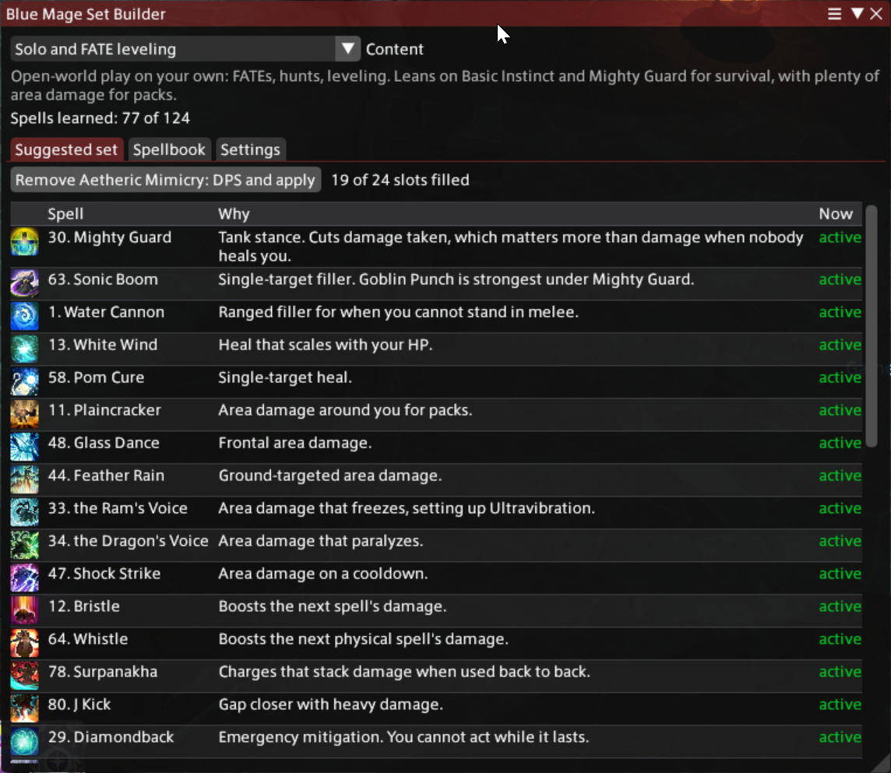

# Blue Mage Set Builder

A Dalamud plugin for FINAL FANTASY XIV. It reads which Blue Mage spells you have
learned and builds a 24-spell active set for the content you are about to do, then
applies it with one click.

The point is to skip working out, every time you switch from FATEs to a dungeon to a
trial, which 24 of your spells to bring, and then ticking them one by one in the Blue
Magic Spellbook.



## Features

- Profiles for **solo and FATE leveling**, **dungeon DPS**, **trial and raid DPS**,
  **tank** and **healer**.
- A suggested set built from the spells you actually know, with the reason each one
  made the cut and which are already active.
- A **Worth learning** list: spells the profile wants that you do not have yet, and
  where to learn each one.
- When a profile's first choice is not learned, a weaker stand-in takes the slot, so a
  low-level Blue Mage still gets a usable set rather than gaps.
- The whole spellbook in one table: number, rank, learned or not, and where to get it.
  Any spell can be excluded from every suggestion, for example one you find awkward.
- Applying keeps spells that are already active in the slots they are in, so as little
  moves as possible.
- Aetheric Mimicry handled for you: spells cannot be changed while it is up, so the
  button offers to click it off, apply the set, and remind you to recast it.
- `/blusets apply <profile>` for macros.
- Profiles are a plain JSON file you can export, edit in any text editor, and reload
  without touching the plugin.

## Installing

The plugin is distributed through my custom Dalamud repository.

1. Type `/xlsettings` in game.
2. Open the **Experimental** tab.
3. Paste this into the empty box under **Custom Plugin Repositories**:

   ```
   https://raw.githubusercontent.com/joshua88wa/FFXIV/main/Dalamud/repo.json
   ```

4. Press **+**, make sure the checkbox next to it is on, then press **Save and Close**.
5. Open `/xlplugins`, search for Blue Mage Set Builder, and install it.

If nothing shows up, press the refresh icon at the top left of the plugin installer.

Other plugins in the same repository are listed at
[joshua88wa/FFXIV](https://github.com/joshua88wa/FFXIV).

## Using it

1. Type `/blusets`.
2. Pick what you are about to do from **Content**.
3. Read down the suggested set. Each spell shows why it was picked.
4. Press **Apply this set**.

The window works on any job, so you can plan from anywhere, but applying needs you to
be on Blue Mage.

## Commands

- `/blusets` opens or closes the window
- `/blusets apply <profile>` applies a profile. Takes a profile id (`solo`, `dungeon`,
  `boss`, `tank`, `healer`) or the start of its name, so `/blusets apply trial` works.
  With no name it applies the profile selected in the window.
- `/blusets config` opens the settings tab
- `/blusets debug` prints what the plugin can see to chat, which is the first thing to
  include in a bug report

## When spells cannot be changed

The game refuses to change spells in combat, mid-cast, while zoning or in a cutscene,
while Aetheric Mimicry is active, and once a Masked Carnivale stage has started. The
plugin checks for all of these before trying except the Carnivale lock, which it
reports when the game refuses.

When Mimicry is the only thing in the way, the button changes to **Remove Aetheric
Mimicry and apply**. It clicks the buff off, waits for it to drop, applies the set,
and reminds you to recast it. `/blusets apply` stops and tells you instead, unless you
turn on **Let /blusets apply click off Aetheric Mimicry** in Settings.

If the game refuses a change for a reason the plugin does not know about, the message
lists your current buffs. Please report it with that list so the cause can be added.

## Settings

- **Keep spells in the same slot when applying.** On by default.
- **Let /blusets apply click off Aetheric Mimicry.** Off by default, because it means
  recasting Mimicry. The button in the window always names the buff before removing it.
- **Show spells I have not learned** on the Spellbook tab.
- **Exclude** any spell from every suggested set, on the Spellbook tab.
- **Profiles:** export, reload, open the config folder, or go back to the built-in set.

## Editing the profiles

Settings tab, **Export the built-in profiles for editing**, then **Open config folder**
and edit `Profiles.json`. Each profile is a list of picks in priority order:

```json
{ "Any": [ 105, 63, 1 ], "Why": "Single-target filler." }
```

A pick fills one slot with the first spell in `Any` that you have learned, have not
excluded, and is not already in the set. The numbers are the ones in the Blue Magic
Spellbook, which are the same in every client language. Picks stop once 24 slots are
full. Press **Reload profiles** after saving.

Your copy replaces the built-in profiles completely, so new profiles added in a later
version will not appear until you delete your copy from the Settings tab or merge them
in by hand.

The built-in profiles are a reasonable starting point, not a tuned meta. Suggestions
for better ones are welcome.

## Notes

**The spell list** comes from the game's own `AozAction` and `AozActionTransient`
sheets, so spells added in a patch appear without a plugin update. They only get into
a suggested set once a profile names them.

**Learned or not** is read from the unlock bit that each spell's `Action` row points
at through `UnlockLink`. `/blusets debug` checks this against your active set: every
spell in an active slot has to be learned, so a disagreement means the check is wrong.

**Applying** writes all 24 slots at once through `ActionManager.SetBlueMageActions`,
the same call the game uses to load a saved active set, then reads the slots back to
confirm the change took. It does not touch your five saved active sets or your
hotbars.

**Aetheric Mimicry** is removed with `StatusManager.ExecuteStatusOff`, which is what
right-clicking a buff does.

## Problems and suggestions

Open an issue:
[github.com/joshua88wa/FFXIV-Dalamud-BlueMageSetBuilder/issues](https://github.com/joshua88wa/FFXIV-Dalamud-BlueMageSetBuilder/issues)

## Credits

Game structures come from
[FFXIVClientStructs](https://github.com/aers/FFXIVClientStructs).

Written with the help of an LLM, in case that matters to you.

## Building

Needs the .NET 10 SDK and an XIVLauncher install, which is where the Dalamud reference
assemblies come from.

```
cd BlueMageSetBuilder
dotnet build -c Release
```

The build lands in `BlueMageSetBuilder/bin/Release/`, with a packaged `latest.zip`
alongside it.

The icon is drawn by `tools/make-icon.ps1`. Change the numbers there and re-run it
rather than editing `images/icon.png`.

## License

[0BSD](LICENSE). Do whatever you want with it. No attribution, no notice to carry
around, no conditions at all. The license text is there to say the software comes with
no warranty, and nothing else.
